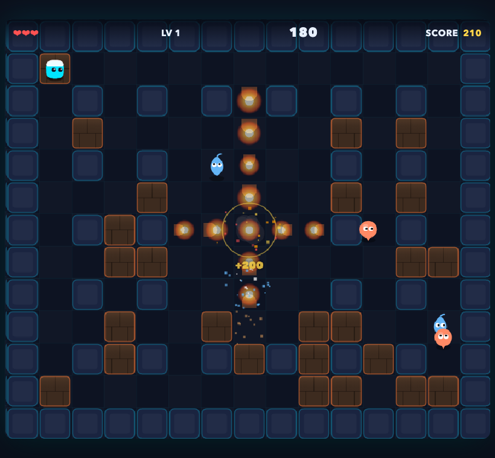

# BOMBER GO 💣

A modern browser remake of the classic Bomberman. **Zero external assets** — every sprite is drawn procedurally on canvas and every sound is synthesized with the Web Audio API.

Built with **Vite + TypeScript**. No game engine; the only runtime dependency is [PeerJS](https://peerjs.com/) for online play.



## Play

```sh
npm install
npm run dev        # → http://localhost:5173
```

Production build:

```sh
npm run build      # outputs to dist/
npm run preview
```

## Features

- **Career mode** — endless procedurally generated levels. Blast every enemy, find the hidden exit, beat the clock.
- **Battle mode** — 1P vs AI or 2P local on one keyboard. Best-of-3 rounds (fresh map each round, stats persist); sudden death bomb rain when a round's timer expires.
- **Classic enemy roster, modern AI** — 8 enemy types: wanderers, axis-chasers, BFS pathfinders, wall-passing ghosts, flee/ambush bots. The player AI (attract / battle / demo) bombs before it dodges, and never self-destructs: a bomb is only placed if a BFS proves the player can walk out of the blast before the fuse runs out. In battle the bot hunts the opponent, backs off at point-blank, **traps** opponents hemmed into dead-ends, blasts bricks behind them to shrink their escape routes, and grabs flame powerups to extend its kill range.
- **11 power-ups** — bomb +, flame +, speed +, shrink bomb, shrink flame, shield, invincibility, wall pass, freeze (stuns enemies — or your opponent in battle), kick, extra life.
- **Chain reactions** — bombs detonate bombs. Multi-kill combos multiply your score (100 → 200 → 400 → 800…).
- **Per-level color themes** — 5 cycling palettes (navy, purple, green, crimson, ice) keep the campaign visually fresh.
- **Sudden death** — as the timer runs down the board starts eating itself, enemies speed up, and the music tempo rises.
- **Online battle** — 1P vs a remote opponent over PeerJS (WebRTC data channel, public cloud broker). One player creates a room and shares the 5-letter code; the other joins. Host-authoritative netcode: the client sends inputs only, the host runs the simulation and streams ~20 Hz state snapshots, so both players see the exact same board.
- **Hidden powerups** — items are buried inside destructible bricks. Break the brick and the item is revealed (with a sparkle and an "ITEM!" popup) — then grab it.
- **Attract mode** — AI vs AI battle plays behind the title screen.
- **Procedural audio** — three chiptune tracks (menu, campaign, battle) and fully synthesized SFX. `M` mutes.
- **Juice** — particles, screen shake, score popups, spawn pop-ins, dust trails, glow, freeze/sudden-death effects, **hit-stop slow-mo** on triple+ kills, escalating **combo screen-flash**, ambient **dust motes** drifting over the floor, and a **golden high-score celebration** (burst + flash + fanfare).
- **Modern UI** — neon DOM menus, HUD, pause, high-score board with initials, settings.
- **Inputs** — keyboard, gamepad (2 pads for 2P), and on-screen touch controls on mobile.
- **PWA** — installable, works offline (service worker).
- **High scores** — stored in `localStorage`.

## Controls

| Action | Player 1 | Player 2 |
| --- | --- | --- |
| Move | `W A S D` / arrows | `I J K L` |
| Bomb | `Space` / `F` | `Enter` / `Numpad 0` |
| Detonate oldest bomb | `E` / `G` | `O` / `Numpad 1` |
| Pause | `P` / `Esc` | `P` / `Esc` |
| Mute | `M` | `M` |

## Project layout

```
src/
  constants.ts   tuning values, grid size, powerup defs
  types.ts       shared types
  level.ts       maze generation + connectivity guarantee
  game.ts        core engine: movement, bombs, AI, rules
  enemies.ts     enemy roster
  render.ts      procedural canvas renderer
  particles.ts   particle system
  audio.ts       WebAudio SFX + chiptune sequencer
  input.ts       keyboard / gamepad / touch input
  net.ts         PeerJS wrapper: room codes, data channel
  netgame.ts     online state: serialize / RemoteGame / snapshot diff
  ui.ts          DOM overlay UI
  storage.ts     settings + high scores (localStorage)
  main.ts        bootstrap, app state machine, loop
test/smoke.ts    headless logic simulation (npx tsx test/smoke.ts)
test/qa-long.ts  extended 5-min stability runs (npx tsx test/qa-long.ts)
test/qa-curve.ts multi-run AI difficulty probe (npx tsx test/qa-curve.ts [runs])
public/sw.js     offline service worker
```

## Debug hooks

Append to the URL for deterministic testing:

- `?start=campaign` — jump straight into a career run
- `?start=battle&ai=1` — battle vs AI
- `?start=demo&steps=N` — AI plays career, pre-advanced N/60 s
- `?start=flame` — staged explosion, frozen at peak (render tests)
- `?start=clear&steps=120` — level-clear screen
- `?start=over&steps=120` — game-over / high-score entry screen
- `?start=pause` — paused game
- `&level=N` — jump campaign to level N (theme checks)
- `&steps=N` — pre-advance the simulation N/60 s (works with any start)

## Notes

- Movement is grid-locked with buffered turns, simulated at a fixed 60 Hz timestep.
- Maps guarantee that every power-up, the exit, and every enemy spawn is reachable.
- The game is deterministic per map seed except for enemy wander randomness.
- Rendering is performance-minded: floors are pre-rendered per theme and flame effects use pre-rendered sprites, so big multi-bomb explosions stay at 60 fps on modest hardware.
